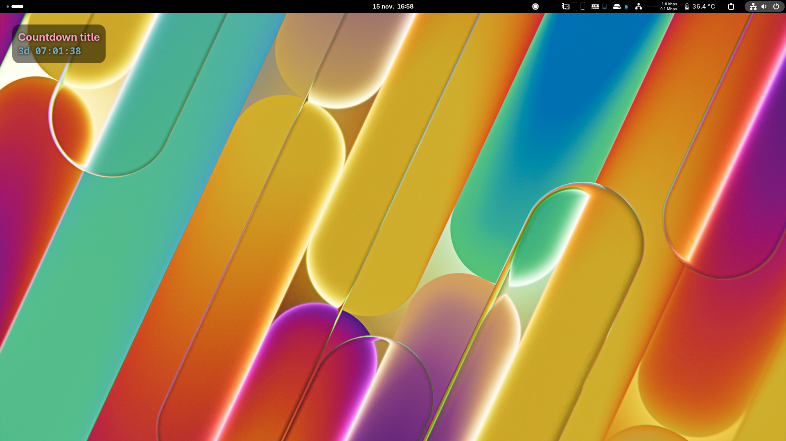
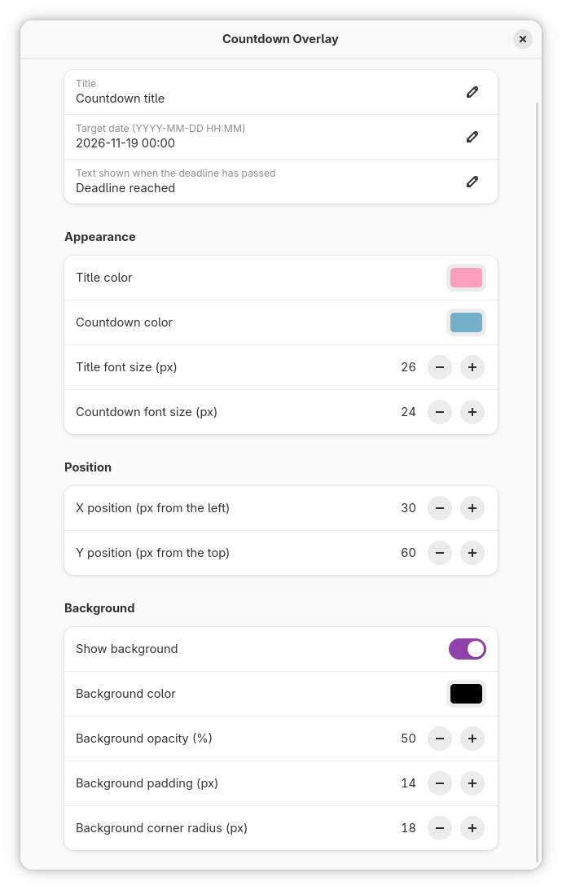

# Countdown Overlay (GNOME Shell extension)

Displays a title and a live countdown to a target date on the desktop. The overlay is drawn on the background layer so it stays behind application windows.

## Features

- Live countdown to a target date/time
- Optional title (hidden automatically if empty)
- Customizable colors and font sizes
- Adjustable position on the primary monitor
- Optional semi-transparent background with configurable padding and corner radius

## Installation

```bash
./install.sh
```

On Wayland, log out and back in after installing.
On X11, press Alt+F2, type `r`, and press Enter to reload GNOME Shell.

After, to enable the extension, run:

```bash
gnome-extensions enable countdown-overlay@paulo89.dev
```

Or use a Gnome Extension manager.

## Settings

Open the Extensions app, or run:

```bash
gnome-extensions prefs countdown-overlay@paulo89.dev
```

## Screenshot




